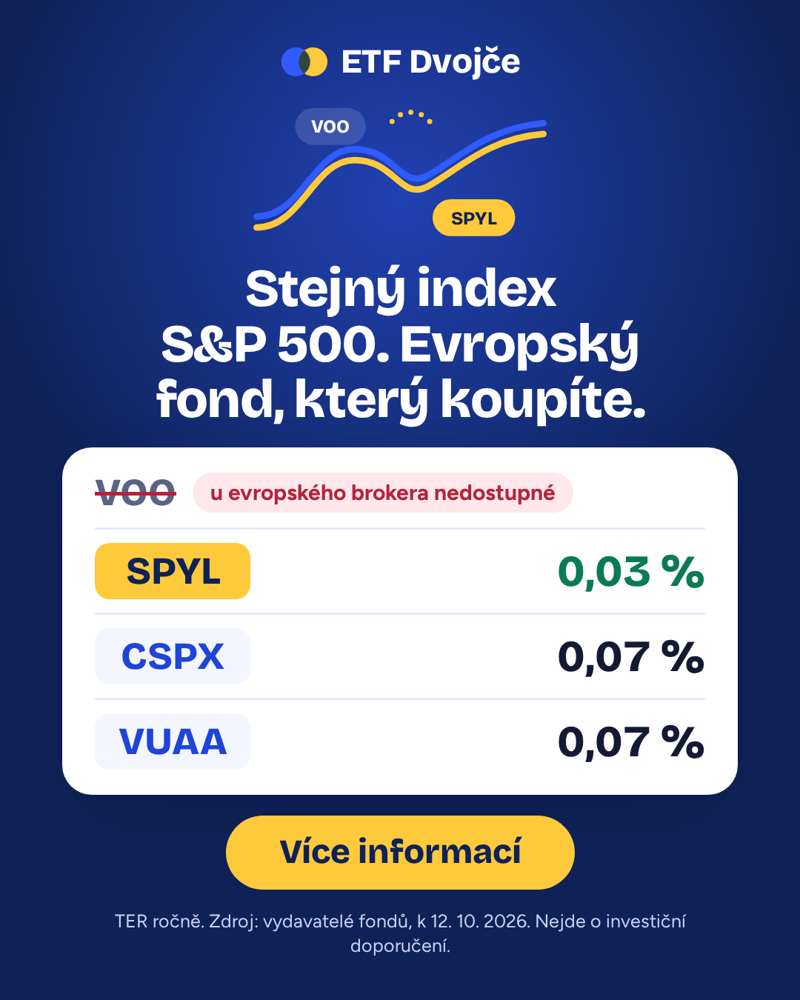
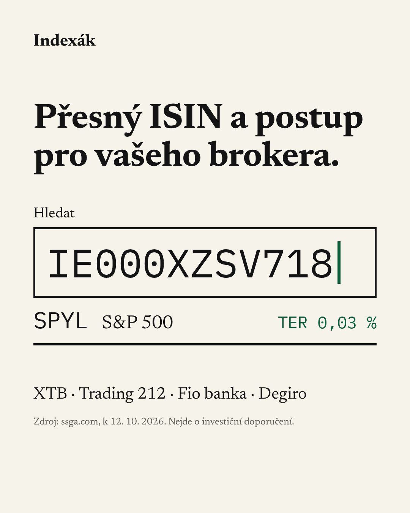

# ETF Dvojče – „Najdi evropské dvojče"

## Výklad zadání

Srovnáváme ETF obchodované na NYSE (Arca). Protože je český drobný investor u evropského brokera kvůli nařízení PRIIPs koupit nemůže, ke každému ukazujeme dostupný evropský ekvivalent. Bez toho by srovnání nemělo použitelný výstup. Originály z NYSE jsou na stránce vždy vidět vedle dvojčat (TER, burza, zdroj).

Zadání B od Clientela (clientelo.cz) pro přijímací řízení. Stránka běží pod fiktivní spotřebitelskou značkou ETF Dvojče; jako demo ji provozuje neutrální provozovatel „ETF Dvojče – ukázkový projekt" (kontakt etf-dvojce@seznam.cz, bez IČO a sídla), který údaje nikomu nepředává. Pro ostré spuštění u klienta se mění jediný soubor `src/lib/operator.ts` a seznam partnerů v zásadách – viz checklist.

Výstupy: landing page (Astro 5 + React ostrůvky, TypeScript, SCSS), PDF návod jako lead magnet, 2 verze reklamy ve formátech 4:5 a 9:16, měření celé cesty a tento README.

**Mohli bychom zítra spustit reklamu?** Po stránce kódu ano: stránka, formuláře, PDF, kreativy, měřicí kód a testy jsou hotové a lokálně otestované. Web ale zatím nikde neběží, takže se na produkci zatím nic neměřilo – Pixel, CAPI, PostHog ani doručení e-mailu s návodem z Brevo nejsou ověřené v ostrém provozu. Ostrý provoz blokují kroky mimo kód – výměna ukázkového provozovatele a souhlas klienta, schválení právníkem, produkční účty a placené tarify, ověření dat brokerů Trading 212 a Fio a ověření měření na produkci. Přesný stav je v [checklistu před spuštěním reklamy](#checklist-před-spuštěním-reklamy).

## Cílová skupina

**Primární:** začínající až mírně pokročilý český drobný investor, 25–45 let, na mobilu. O „ETF na S&P 500" (VOO, SPY) slyšel z YouTube, Redditu, podcastů nebo od známých. Chce pravidelně investovat menší částky (stovky až nízké tisíce Kč měsíčně) a účet u brokera má nebo zakládá (XTB, Trading 212, Fio, Degiro).

**Bolest:** u evropského brokera americké ETF nenajde, nebo neví, kterou z mnoha evropských verzí vybrat a jak ji v aplikaci najít.

**Co přesvědčí:**
- konkrétní odpověď během pár sekund,
- věcný tón bez slibů výnosů,
- viditelný zdroj dat,
- praktický postup pro jeho brokera.

**Co odradí:**
- dlouhý formulář,
- slib „zbohatnete",
- pocit skrytého prodeje,
- nečitelná tabulka na mobilu,
- žargon bez vysvětlení.

## Nabídka a moment žádosti o kontakt

**Zdarma, bez kontaktu:** hned na první obrazovce odpověď pro S&P 500 – originály z NYSE (VOO, SPY, IVV) a jejich evropská dvojčata s TER a zdrojem. Pod ní další NYSE fondy (VT, VTI, SCHD) a kalkulačka poplatků.

**Za e-mail:** PDF „Jak koupit S&P 500 a další americké indexy u XTB, Trading 212, Fio a Degiro":
- pro každého brokera: která dvojčata nabízí, ticker k vyhledání, poplatek za nákup a postup krok za krokem (jen údaje ověřené u brokera; co ověřené není, PDF výslovně uvádí jako neověřené),
- tabulka všech párů originál → dvojče s TER a ISIN,
- akumulace vs. distribuce a co to znamená pro daně v ČR (časový test).

**Proč právě návod ke koupi:** je to jediná hodnota, kterou stránka zdarma nedává. Co koupit, ukážeme hned; jak to koupit u *vašeho* brokera, je v návodu – po odeslání formuláře si ho hned stáhnete na `/dekujeme` a stejný návod pošleme i e-mailem.

**Hlavní moment žádosti:** na první obrazovce, přímo pod kartou odpovědi. K odeslání nevede žádná interakce navíc. Další místa: odkaz „Poslat návod pro tento fond" v kartách dalších fondů, formulář pod výsledkem kalkulačky, formulář u náhledu návodu a sticky lišta.

**Po odeslání:**
1. Server vytvoří kontakt v Brevo jedním voláním (`POST /v3/contacts` se seznamem, single opt-in) a přesměruje na `/dekujeme?aid=…`.
2. `/dekujeme` – „Hotovo. Návod je váš.", hned pod nadpisem tlačítko „Stáhnout návod (PDF)", pak výběr brokera (hned ukáže dvojčata u něj) a nepovinný telefon.
3. Automatizace Brevo „kontakt přidán do seznamu" pošle stejný návod e-mailem (text v [docs/brevo-setup.md](docs/brevo-setup.md) § 6).

## Pořadí sekcí a proč

| # | Sekce | Otázka návštěvníka |
|---|---|---|
| 1 | **Hero** – nadpis podle varianty reklamy, podnadpis s přínosem, karta odpovědi S&P 500 (originály NYSE + dvojčata, TER, zdroj), e-mailový formulář | „Jsem tu správně a co tu dostanu?" |
| 2 | **Další fondy** – čipy VTI / VT / SCHD → karta s originálem, dvojčaty (nebo poctivým „přesné dvojče neexistuje") a odkazem „Poslat návod pro tento fond" | „A co můj fond?" |
| 3 | **Kalkulačka „Kolik stojí poplatky"** – dvojčata mezi sebou + srovnávací řádek fondu s poplatkem 1,5 % p.a.; pod výsledkem formulář | „Kolik to dělá v penězích?" |
| 4 | **„Proč VOO u evropského brokera nekoupíte"** – PRIIPs/KID ve 3 větách, výjimky | „Proč bych tomu měl věřit?" |
| 5 | **Co je v návodu** – náhled stran PDF, výčet obsahu, formulář | „Co přesně dostanu?" |
| 6 | **FAQ** – zdarma? spam? co je KID? daně? kdo za tím stojí? | „Kde je háček?" |
| 7 | **Patička** – provozovatel, předávání kontaktů, disclaimery, ochranné známky, zásady, cookies | „Kdo to provozuje?" |

**Zdůvodnění pořadí:** studený návštěvník z reklamy rozhoduje během pár sekund, proto první obrazovka obsahuje slib reklamy, odpověď i formulář najednou – k odeslání není potřeba žádná interakce. Hodnota je ukázaná (které dvojče, za kolik), ale ne kompletní (jak ho koupit u mého brokera) – právě tu mezeru zaplňuje návod. Další sekce slouží těm, kdo ještě nejsou rozhodnutí, v pořadí jejich otázek: můj fond → kolik to dělá → proč věřit → co dostanu → háček → kdo to provozuje. Každá má vlastní cestu ke kontaktu.

**Rozpočet první obrazovky (390×844):** nadpis (2 řádky) + podnadpis (2 řádky) + karta (cca 180 px) + pole a tlačítko. Hlídají to E2E testy v `tests/e2e/hero.spec.ts`: „hero form button above fold" (pro varianty A, B i bez UTM) a „hero button is above the banner and not covered by it" (tlačítko nezakrývá cookie lišta). Pořadí sekcí ověřuje `tests/e2e/homepage.spec.ts` („sections in spec §4 order").

## Cesta od každého prvku ke kontaktu

| Prvek | Cesta ke kontaktu | Událost |
|---|---|---|
| Karta odpovědi S&P 500 (hero) | formulář přímo pod ní (0 interakcí) | `form_viewed{placement:hero}` |
| Karty dalších fondů | odkaz „Poslat návod pro tento fond" → fokus do nejbližšího formuláře s předvyplněným fondem | `card_cta_clicked{pair}` |
| Kalkulačka | formulář pod výsledkem | `form_viewed{placement:calc}` |
| Náhled návodu | formulář v sekci | `form_viewed{placement:preview}` |
| Sticky lišta | skok na nejbližší formulář | `sticky_cta_clicked` |

## Klíčová rozhodnutí

### PRIIPs: proč VOO u evropského brokera nekoupíte

Od roku 2018 musí mít v EU každý investiční produkt nabízený drobným investorům sdělení klíčových informací (KID). Američtí vydavatelé ho pro ETF obchodovaná v USA nevydávají, takže je evropský broker drobnému investorovi neprodá. Výjimky: kdo americké ETF už drží, může je držet i prodat; nové nákupy jsou možné jen pro profesionální klienty. Zdroje na stránce: [Nařízení (EU) č. 1286/2014](https://eur-lex.europa.eu/eli/reg/2014/1286/oj), [justETF](https://www.justetf.com/en/news/etf/us-domiciled-etfs.html) (sekundární zdroj – posoudí právník).

### Lead magnet = návod ke koupi u vašeho brokera

Srovnání fondů je na stránce zdarma celé. Za e-mail nabízíme to, co stránka nedává: konkrétní ticker a postup v aplikaci vašeho brokera. Nabídka je tak srozumitelná za pár sekund a navazuje přímo na bolest cílové skupiny.

### Formulář na první obrazovce

Návštěvník z reklamy často neodroluje. Proto je formulář hned pod odpovědí a nemusí nic rozkliknout. Níže položené formuláře zachytí ty, kdo ještě nejsou rozhodnutí – viz [cesta od každého prvku ke kontaktu](#cesta-od-každého-prvku-ke-kontaktu). Hlavní KPI se rozpadá podle `placement`, takže uvidíme, kolik konverzí přišlo z hero.

### Kalkulačka srovnává dvojčata mezi sebou

Model je ilustrativní: roční zhodnocení indexu R = 7 % p.a. před náklady, měsíční vklad 500–50 000 Kč (výchozí 3 000 Kč), horizont 5–40 let (výchozí 20 let). Pro kontext přidáváme řádek „fond s poplatkem 1,5 % p.a. (příklad)" – při výchozích vstupech zaplatí na poplatcích cca 236 000 Kč, dvojčata S&P 500 5 200–12 000 Kč. Originál s dvojčetem nesrovnáváme: VOO má TER 0,03 %, takže by kalkulačka ukázala nulový nebo záporný rozdíl a návštěvník originál stejně koupit nemůže. Smysl má srovnání toho, co koupit **může**. Nemodelujeme poplatky brokera, kurzové konverze, spready, daně ani tracking difference (uvedeno pod výsledkem). Kód: `src/lib/calc.ts`.

### Daně

Srážková daň z amerických dividend je srovnatelná: irský fond platí 15 %, Čech u amerického ETF s formulářem W-8BEN také 15 %. Rozdíl je v české dani: u amerického ETF se výplaty dividend každý rok daní a přiznávají, u akumulačního irského dvojčete se dividendy reinvestují uvnitř fondu a zisk z prodeje po 3 letech držení (časový test) je osvobozen. Pro českého investora je tedy akumulační dvojče daňově spíš výhodnější. Na stránce i v PDF jako obecná informace, ne daňové poradenství.

### Bez QQQ a bez syntetických fondů

QQQ se neobchoduje na NYSE, ale na Nasdaqu („Invesco QQQ Shares are listed on NASDAQ under the symbol "QQQ."" – [prospekt na sec.gov, 31. 1. 2025](https://www.sec.gov/Archives/edgar/data/1067839/000119312525013448/d902673d485bpos.htm)); vynechání bylo i upřesněno se zadavatelem. Validace dat QQQ odmítne. Syntetické (swapové) fondy nezařazujeme, protože jejich náklady nelze poctivě srovnat jen podle TER; validace dat je také odmítne.

### Reklama B nestaví na čísle v korunách

Rozdíl mezi dvojčaty S&P 500 (SPYL vs. VUAA) je při 3 000 Kč měsíčně a 20 letech jen cca 6 900 Kč (přesně ≈ 6 870 Kč z `computeFees`, ověřeno testem v `tests/unit/calc.test.ts`; stránka zaokrouhluje na stovky). Slib „ušetříte" by byl slabý a zavádějící, proto B prodává praktičnost: přesný ISIN a postup pro vašeho brokera.

### Bez skládání portfolia a kvízu

Personalizovaný výběr fondů („jaký jste investor") se blíží investičnímu doporučení. Stránka proto jen ukazuje fakta o fondech na stejný index a postup koupě.

### Single opt-in: návod hned po odeslání

Slíbenou hodnotu návštěvník dostane hned: PDF ke stažení na `/dekujeme` a stejný návod e-mailem, nic dalšího nepotvrzuje. Single opt-in jsme zvolili místo double opt-in (DOI), protože DOI není v ČR právně nutný pro zaslání návodu, o který si člověk sám řekl, s každým krokem navíc by část leadů odpadla a kvalitu leadu ověřuje validace e-mailu (v prohlížeči i na serveru, s honeypotem a rate limitem) a telefonát. Cena: v seznamu skončí víc neplatných nebo cizích adres; hlídáme proto míru tvrdých odrazů e-mailu s návodem v Brevo. Souhlas s obchodními sděleními zůstává jako text pod tlačítkem formuláře. Telefon a broker se ke kontaktu přiřazují přes `aid` (v Brevo `ext_id`), takže e-mail potvrzovat nemusí. Když Brevo `aid` odmítne kvůli konfliktu identifikátoru (stejné `aid` už má jiný kontakt, např. po opravě překlepu v e-mailu), server zkusí jednou nové `aid` a přesměruje s ním; pokud konflikt trvá (e-mail už má jiné `ext_id`), kontakt se uloží bez `ext_id` a s novým `aid` v atributu `AID`, na které se přesměruje – e-mail s návodem přijde, ale broker a telefon z této návštěvy se ke kontaktu nepřiřadí (vznikne kontakt bez e-mailu, nikdy se nepřipíšou cizímu kontaktu).

### Telefon až po e-mailu, dva oddělené souhlasy

E-mail je jediné pole formuláře (nejnižší tření). Nepovinný telefon nabízíme až na `/dekujeme`, pod tlačítkem pro stažení návodu, s uvedením, kdo volá. Dva samostatné nezaškrtnuté souhlasy: (a) telefonický kontakt provozovatelem, (b) předání údajů jmenovitě uvedeným partnerům; odeslat lze s (a) bez (b). Telefonát vede provozovatel podle písemného skriptu bez osobních investičních doporučení (jen postup v aplikaci brokera a obecné informace).

### Měření bez souhlasu a se souhlasem

Bez souhlasu běží jen PostHog v `cookieless_mode` (anonymní agregované události bez trvalého ID); Meta Pixel, CAPI a GA4 nikdy. `aid` se bez souhlasu do PostHogu neposílá ani v adresách: `before_send` ho odstraní z `$current_url`, `$referrer` a všech ostatních hodnot i klíčů vlastností události; heatmapy jsou navíc vypnuté (`capture_heatmaps: false`), protože jejich data jsou klíčovaná adresou stránky (ověřeno testem s reálnou knihovnou posthog-js na `/dekujeme?aid=…`). Když návštěvník souhlas s analytikou udělí, PostHog se přepne na trvalé úložiště bez znovunačtení stránky (žádný druhý `page_view` ani Meta `PageView`, rozepsaný e-mail zůstane) a `identify(aid)` propojí celou cestu včetně `/dekujeme`; z adres se `aid` odstraňuje i se souhlasem. Stránka se znovu načte jen při odvolání souhlasu. Zdrojem pravdy pro počet kontaktů je Brevo.

## Reklamy A/B

Meta (Instagram + Facebook), kategorie kampaně Financial products and services; počítáme s omezeními Meta pro finanční weby (Core Setup). Obě verze vedou na stejnou URL; podle `utm_content` (první písmeno `a`/`b`) se mění nadpis a podnadpis hero, karta S&P 500 a formulář zůstávají. Bez UTM se zobrazí hero A. Texty i URL s UTM: [ads/copy.md](ads/copy.md).

### Verze A – „Problém"



Formát [9:16](ads/a-9x16.png).

- **Primární text:** Hledali jste u brokera VOO a nenašli ho? Není to chyba. Evropská pravidla brání brokerům prodávat americké ETF drobným investorům. Na stejný index S&P 500 ale existují evropské fondy. Podívejte se, které to jsou a co stojí.
- **Titulek:** VOO u evropského brokera nekoupíte. Tady je náhrada.
- **Tlačítko:** Více informací
- **Hero A:** „U evropského brokera VOO jako drobný investor nekoupíte. Jeho evropské dvojče ano." / „Níže vidíte, které fondy sledují stejný index a kolik stojí. Návod, jak je koupit u vašeho brokera, vám pošleme zdarma."
- **URL:** `{SITE_URL}/?utm_source=meta&utm_medium=paid_social&utm_campaign=etf_dvojce_launch&utm_content=a-4x5` (resp. `a-9x16`)

### Verze B – „Praktický návod"



Formát [9:16](ads/b-9x16.png).

- **Primární text:** Máte účet u XTB, Trading 212, Fio nebo Degira a chcete investovat do S&P 500? Nemusíte hledat ve stovkách fondů. Pošleme vám přesný ISIN a postup pro vašeho brokera.
- **Titulek:** S&P 500 u vašeho brokera: přesný ISIN a postup
- **Tlačítko:** Získat návod
- **Hero B:** „S&P 500 u vašeho brokera: který fond vybrat a jak ho najít." / „Tři evropské fondy na S&P 500 a jejich poplatky vidíte hned. Postup pro XTB, Trading 212, Fio a Degiro vám pošleme e-mailem."
- **URL:** `{SITE_URL}/?utm_source=meta&utm_medium=paid_social&utm_campaign=etf_dvojce_launch&utm_content=b-4x5` (resp. `b-9x16`)

Čísla a ISIN na kreativách generuje `npm run ads` z `src/data/etf-pairs.json` (stejný skript vyrenderuje `public/og.png`). Oproti návrhu ve spec §9 používají kreativy motiv `⇄` a pořadí dvojčat z dat; u verze B je řádek brokerů označen „Postup pro: …" a zdrojová řádka dodává „Dostupnost fondů se u brokerů liší.", aby kreativa netvrdila, že každý broker nabízí SPYL.

## Očekávaná konverze

Jde o **odhad** týmu, ne benchmark se zdrojem; ověří se daty.

| Metrika | Odhad | Zdůvodnění |
|---|---|---|
| Návštěvník → odeslaný e-mail | **3–6 %** | studený mobilní provoz z Meta ve financích; zvyšuje: formulář na první obrazovce, jediné pole, praktický lead magnet; snižuje: finance, pár sekund pozornosti |
| Lead → stažení PDF na `/dekujeme` | **60–80 %** (odhad) | tlačítko je první prvek pod nadpisem; část lidí počká na e-mail nebo stránku zavře |
| Lead → telefon | **3–8 %** | nepovinné, nabídnuto jednou na `/dekujeme` |

První vyhodnocení má smysl po cca 1 000 návštěv na variantu – jako kontrola, že trychtýř funguje a odhad není mimo. Na rozhodnutí A/B testu je potřeba víc (viz další sekce).

## A/B hypotézy

Seřazeno podle očekávaného dopadu na počet leadů, ne podle velikosti efektu: H3 (+40 %) je až za H2 (+30 %), protože hýbe menší, sekundární metrikou (míra telefonů mezi leady), kdežto H2 mění hlavní konverzi. Dvouvýběrový test podílů, oboustranný, α = 0,05 (z = 1,960), síla 0,8 (z = 0,842):

```
n na variantu = ( z₁₋α/₂ · √(2·p̄·(1−p̄)) + z₁₋β · √(p₁(1−p₁) + p₂(1−p₂)) )² / (p₂ − p₁)²
```

Baseline p₁ = 4 % (střed odhadu), relativní zlepšení 20 % → p₂ = 4,8 %, p̄ = 4,4 %:
(1,960 · √(2 · 0,044 · 0,956) + 0,842 · √(0,04 · 0,96 + 0,048 · 0,952))² / 0,008² = (0,5685 + 0,2442)² / 0,000064 ≈ **10 319 návštěvníků na variantu** (≈ 20 638 celkem).

Při ~1 000 návštěvách na variantu je nejmenší spolehlivě zjistitelný efekt ≈ +71 % relativně (4 → ≈ 6,8 %). Proto první vyhodnocení po 1 000 návštěvách slouží ke kontrole trychtýře, ne k vyhlášení vítěze.

| # | Hypotéza | Varianty | Hlavní metrika | Očekávaný efekt | Vzorek na variantu |
|---|---|---|---|---|---|
| 1 | Nabídka je největší páka konverze | „Návod ke koupi u vašeho brokera" vs. „Tahák všech dvojčat" | konverze; sekundárně míra telefonů | +50 % relativně (4 → 6 %) | ≈ 1 863 návštěv |
| 2 | Formulář na první obrazovce zvyšuje konverzi bez ztráty kvality | formulář pod odpovědí v hero vs. až pod kalkulačkou | konverze; hlídací metrika míra tvrdých odrazů e-mailu s návodem (Brevo) | +30 % relativně (4 → 5,2 %) | ≈ 4 784 návštěv |
| 3 | Nabídka telefonu nad tlačítkem PDF zvýší podíl telefonů, protože ji uvidí každý lead | na `/dekujeme` nabídka telefonu nad tlačítkem „Stáhnout návod (PDF)" vs. pod ním (dnešní stav) | míra telefonů z leadů (`phone_submitted` / leady); hlídací metrika `pdf_downloaded` / leady | +40 % relativně (5 → 7 % leadů) | ≈ 2 213 leadů ≈ 55 300 návštěv (při konverzi 4 %) |

Vzorek H3 je v leadech, protože se randomizuje až na `/dekujeme`: výchozí míra p₁ = 5 % (v dolní polovině odhadu 3–8 % „lead → telefon"), p₂ = 7 % (+40 % relativně), p̄ = 6 %: (1,960 · √(2 · 0,06 · 0,94) + 0,842 · √(0,05 · 0,95 + 0,07 · 0,93))² / 0,02² = (0,6583 + 0,2825)² / 0,0004 ≈ **2 213 leadů na variantu**; při konverzi 4 % to je 2 213 / 0,04 ≈ 55 300 návštěv na variantu. Test reklam A vs. B běží paralelně na úrovni kreativ v Meta (metrika: konverze podle `hero_variant` / `utm_content`). Efekty jsou předpoklady pro plánování vzorku, ne slib.

## Měření

**Nástroje:**
- **PostHog EU cloud** (`eu.i.posthog.com`, `person_profiles: 'identified_only'`) – bez souhlasu `cookieless_mode`, se souhlasem `identify(aid)`; `aid` z adres v událostech vždy odstraňuje `before_send`.
- **Meta Pixel + Conversions API** – jen se souhlasem; `Lead` se sdíleným `event_id` pro deduplikaci, e-mail hashovaný SHA-256.
- **GA4 (Consent Mode v2)** – jen se souhlasem.
- **Brevo** – zdroj pravdy pro počet kontaktů a doručitelnost e-mailu s návodem (tvrdé odrazy).

Cookie lišta má stejně výrazná tlačítka „Odmítnout" a „Přijmout" a nastavení po účelech (analytika / Meta / GA4).

**Události:**

| # | Událost | Parametry |
|---|---|---|
| 1 | `page_view` | utm_source, utm_campaign, utm_content, hero_variant |
| 2 | `form_viewed` | placement |
| 3 | `form_started` | placement |
| 4 | `form_submitted` / `form_error` | placement / error_type |
| 5 | `thankyou_viewed` | |
| 6 | `broker_selected` | broker |
| 7 | `phone_submitted` | page, consent_partners |
| 8 | `pdf_downloaded` | |
| – | `pair_selected`, `card_cta_clicked`, `calc_used`, `calc_result_viewed`, `sticky_cta_clicked`, `faq_opened`, `source_link_clicked`, `scroll_depth` | |

**Metriky podle varianty reklamy:**
- **Konverze** = `form_submitted` / unikátní návštěvníci (hlavní KPI), rozpad podle `placement`.
- Míra stažení PDF z leadů (`pdf_downloaded` / leady), míra telefonů z leadů, podíl leadů s vybraným brokerem, míra tvrdých odrazů e-mailu s návodem (z Brevo).
- Odpad mezi kroky; kolik konverzí přišlo z hero vs. níže.

Pozor při čtení: `pdf_downloaded` se počítá při každém kliknutí na tlačítko na `/dekujeme` (i opakovaném) a nevidí stažení z odkazu v e-mailu. Bez souhlasu nelze cestu po odeslání propojit na úrovni osoby, porovnávají se agregované počty.

**PostHog dashboard** „ETF Dvojče – konverze": ČEKÁ na vytvoření po nasazení, postup v [docs/brevo-setup.md](docs/brevo-setup.md) § 9.6.

**Výkon (cíl LCP < 1,5 s, CLS < 0,1):** [docs/lighthouse-mobile.json](docs/lighthouse-mobile.json) je z **lokálního** produkčního buildu (12. 10. 2026, Lighthouse 13.5.0, mobil, simulované 4G), ne z produkce:

| Metrika | Lokální build | Cíl |
|---|---|---|
| LCP | 1 089 ms v uloženém běhu; v opakovaných bězích bimodální, cca 1,06 s nebo cca 1,96 s (4 z 8 běhů nad cílem) | < 1 500 ms |
| CLS | 0,0007 | < 0,1 |
| Výkon / přístupnost / best practices / SEO | 1,00 / 1,00 / 1,00 / 1,00 | – |

LCP tedy zatím **nepovažujeme za splněné**; rozhodne měření na produkční URL podle [docs/brevo-setup.md](docs/brevo-setup.md) § 9.5.

## Zdroje dat

`src/data/etf-pairs.json` a `src/data/brokers.json` jsou jediný zdroj pro stránku, kalkulačku, PDF i reklamy. Každá hodnota má tvar `{ value, sourceUrl, asOf }`. Primární zdroj je stránka nebo factsheet vydavatele (u brokerů stránka brokera); agregátor jen ke kontrole. Neověřitelný údaj se nezobrazí ani nedá do PDF. `validateData` v `src/lib/pairs.ts` kontroluje mj., že zdroj je https adresa z povolených domén primárních zdrojů (vydavatelé, SEC, brokeři), kontrolní číslici ISIN, žádný syntetický fond a žádné QQQ.

**Fondy (ověřeno 12. 10. 2026; tabulka vygenerovaná z dat):**

| Fond | Skupina | Role | Index | TER | ISIN | Burza | Distribuce | Zdroj TER |
|---|---|---|---|---|---|---|---|---|
| VOO | S&P 500 | originál | S&P 500 | 0,03 % | US9229083632 | NYSE Arca | dist. | [fund-docs.vanguard.com](https://fund-docs.vanguard.com/F0968.pdf) |
| SPY | S&P 500 | originál | S&P 500 | 0,09 % (0,0945 %) | US78462F1030 | NYSE Arca | dist. | [ssga.com](https://www.ssga.com/us/en/intermediary/etfs/spdr-sp-500-etf-trust-spy) |
| IVV | S&P 500 | originál | S&P 500 | 0,03 % | US4642872000 | NYSE Arca | dist. | [ishares.com](https://www.ishares.com/us/products/239726/ishares-core-sp-500-etf) |
| SPYL | S&P 500 | dvojče | S&P 500 | 0,03 % | IE000XZSV718 | Deutsche Börse | akum. | [ssga.com](https://www.ssga.com/uk/en_gb/institutional/etfs/spdr-sp-500-ucits-etf-spyl-gy) |
| VUAA | S&P 500 | dvojče | S&P 500 | 0,07 % | IE00BFMXXD54 | Deutsche Börse | akum. | [de.vanguard](https://www.de.vanguard/professionell/anlageprodukte/etf/aktien/9694/sp-500-ucits-etf-usd-accumulating) |
| CSPX | S&P 500 | dvojče | S&P 500 | 0,07 % | IE00B5BMR087 | London Stock Exchange | akum. | [ishares.com](https://www.ishares.com/gls-download/literature/fact-sheet/cspx-ishares-core-s-p-500-ucits-etf-fund-fact-sheet-en-gb.pdf) |
| VT | Celý svět | originál | FTSE Global All Cap | 0,06 % | US9220427424 | NYSE Arca | dist. | [fund-docs.vanguard.com](https://fund-docs.vanguard.com/F3141.pdf) |
| SPYY | Celý svět | alternativa | MSCI ACWI | 0,12 % | IE00B44Z5B48 | Deutsche Börse | akum. | [ssga.com](https://www.ssga.com/uk/en_gb/institutional/etfs/spdr-msci-acwi-ucits-etf-spyy-gy) |
| VWCE | Celý svět | alternativa | FTSE All-World | 0,14 % | IE00BK5BQT80 | Deutsche Börse | akum. | [nl.vanguard](https://nl.vanguard/professional/product/etf/equity/9679/ftse-all-world-ucits-etf-usd-accumulating) |
| VTI | Celý americký trh | originál | Morningstar US Total Market (dříve CRSP US Total Market) | 0,03 % | US9229087690 | NYSE Arca | dist. | [advisors.vanguard.com](https://advisors.vanguard.com/investments/products/vti/vanguard-total-stock-market-etf) |
| SCHD | Americké dividendové akcie | originál | Dow Jones U.S. Dividend 100 | 0,06 % | US8085247976 | NYSE Arca | dist. | [schwabassetmanagement.com](https://www.schwabassetmanagement.com/products/schd) |
| FUSD | Americké dividendové akcie | alternativa (jiný index) | Fidelity US Quality Income | 0,25 % | IE00BYXVGX24 | London Stock Exchange | dist. | [fidelityinternational.com](https://www.fidelityinternational.com/FILPS/Documents/en/current/pro.en.xx.IE00BYXVGX24.pdf) |

- **VTI:** přesné dvojče neexistuje a evropskou alternativu s údaji ověřenými u vydavatele zatím neuvádíme (stránka i PDF to říkají).
- **SCHD:** UCITS fond na stejný index neexistuje; FUSD je označen jako jiný index a kalkulačka se pro SCHD ani VTI nenabízí.
- **Celý svět:** jen dvě alternativy (SPYY, VWCE); fondy, jejichž údaje jsme u vydavatele neověřili, nezařazujeme.

**Brokeři (`brokers.json`, ověřeno 12. 10. 2026):**

| Broker | Ověřené fondy (ticker) | Poplatek a postup |
|---|---|---|
| XTB | SPYL, VUAA, CSPX (SXR8.DE), SPYY, VWCE, FUSD | ověřené na xtb.com |
| Degiro | CSPX (SXR8), VWCE, FUSD | ověřené na degiro.cz |
| Trading 212 | **žádné zatím neověřené** (stránky fondů se nepodařilo ověřit) | poplatek a postup z help centra Trading 212 |
| Fio banka | **žádné zatím neověřené** | sazebník a manuál e-Brokera na fio.cz |

U Trading 212 a Fio stránka i PDF poctivě píší „U tohoto brokera jsme dostupnost zatím neověřili." Před spuštěním je nutné dostupnost ručně ověřit a doplnit (viz checklist) – hero B a reklama B slibují postup pro všechny čtyři brokery.

## Měsíční aktualizace dat

- [ ] TER, ISIN, distribuce, replikace a index každého fondu ověřit na stránce nebo factsheetu vydavatele → `value`, `sourceUrl`, `asOf` v `src/data/etf-pairs.json`.
- [ ] U každého brokera: dostupnost každého dvojčete, ticker, poplatek za nákup, postup v aplikaci → `src/data/brokers.json`, `asOf`.
- [ ] `asOf` v `etf-pairs.json` (vrací `getData().asOf`) = datum ověření; zobrazuje se na stránce i v PDF.
- [ ] `npm test` – validace dat a kalkulačka. Hodnota 3 000 Kč / 20 let ≈ 6 900 Kč (SPYL vs. VUAA) se při změně TER může změnit → upravit test i větu o reklamě B v tomto README.
- [ ] `npm run ads` a vizuální kontrola 4 PNG + `public/og.png`; pokud se změnila čísla, nahrát nové kreativy do Meta.
- [ ] `npm run build` (vygeneruje nové PDF), `npm run test:build`, nasazení a kontrola `/navod-etf.pdf` na produkci.
- [ ] Commit `chore(data): monthly update YYYY-MM`.

## Checklist před spuštěním reklamy

### Stav

**Demo: připraveno.** Kód, testy, data fondů, PDF a kreativy jsou hotové. Stránka, PDF i reklamy běží pod značkou ETF Dvojče s ukázkovým provozovatelem „ETF Dvojče – ukázkový projekt" (etf-dvojce@seznam.cz); v demu se údaje žádným partnerům nepředávají.

**Před ostrým spuštěním u klienta:** výměna `src/lib/operator.ts` (skutečný provozovatel a správce) a doplnění seznamu partnerů v zásadách, souhlas klienta s uvedením jako provozovatel, schválení právníkem, skript telefonátu, placené tarify (Vercel Pro/Enterprise, Brevo s vyšším denním limitem a ověřenou doménou), produkční účty k založení (PostHog, Meta, Upstash), ověření dat brokerů Trading 212 a Fio, Lighthouse a E2E na produkci.

Žádný z bodů níže zatím splněný není:

- [ ] Klient (Clientelo) souhlasí s uvedením jako provozovatel / správce; jeho údaje (firma, IČO, sídlo, kontakt) nahradí ukázkového provozovatele v `src/lib/operator.ts` (`OPERATOR`) – jediné místo, odkud je berou patička, FAQ, zásady, cookies a PDF. Spolu s tím doplnit seznam partnerů v zásadách. Nikdy vymyšlený subjekt.
- [ ] Právník klienta schválí: text souhlasu ve formuláři, dva souhlasy u telefonu, seznam partnerů (zatím prázdný – stránka uvádí, že údaje partnerům nepředáváme), zásady, cookie lištu, režim analytiky bez souhlasu, formulace o PRIIPs (včetně justETF jako sekundárního zdroje) a daních. Dále doby uchování (nastavení Brevo a PostHog, kód je nevynucuje), region Upstash v EU, právní základ „doložení souhlasu", přenos dat do USA u GA4 a datum „Platné od" v zásadách.
- [ ] Skript telefonátu bez osobních investičních doporučení.
- [ ] Vercel: tarif/účet klienta pro komerční provoz (Hobby je jen pro nekomerční použití – [vercel.com/docs/limits/fair-use-guidelines](https://vercel.com/docs/limits/fair-use-guidelines)); ideálně vlastní doména.
- [ ] Brevo: tarif s dostatečným denním limitem (bezplatný má 300 e-mailů/den), ověřená odesílací doména (SPF/DKIM), atributy, seznam, šablona a automatizace e-mailu s návodem otestované.
- [ ] Data fondů ověřena u vydavatelů ke dni spuštění; data brokerů ověřena na jejich stránkách – **Trading 212 a Fio zatím nemají žádný ověřený fond**, u Trading 212 ověřit i zdroj poplatku.
- [ ] Meta: Pixel + CAPI ověřené v Events Manageru, kategorie Financial products and services, kontrola Core Setup; `META_TEST_EVENT_CODE` před kampaní smazat.
- [ ] Lighthouse mobile splňuje LCP < 1,5 s a CLS < 0,1; E2E testy zelené na produkční URL (`BASE_URL=… npm run test:e2e`).

Úplný ruční postup a kontrolní seznam: [docs/brevo-setup.md](docs/brevo-setup.md) § 8 (test registrace a e-mailu s návodem) a § 9 (produkční prostředí, § 9.7 kontrola před kampaní).

## Produkční nasazení

**Nasazení zatím neproběhlo** – je to ruční krok vlastníka účtů. Web je připravený k nasazení na Vercel. Po nasazení doplňte sem a do [docs/brevo-setup.md](docs/brevo-setup.md) § 9.8:

- **Produkční URL:** _ČEKÁ – doplní se po nasazení_
- **PostHog dashboard „ETF Dvojče – konverze":** _ČEKÁ – doplní se po vytvoření (§ 9.6)_
- **Lighthouse mobile na produkci:** _ČEKÁ – doplní se po měření (§ 9.5), včetně nesplněných hodnot_

**Postup** (podrobně v [docs/brevo-setup.md](docs/brevo-setup.md) § 9.3):
1. Vercel → Add New → Project → Import GitHub repa; nasazovaná větev musí obsahovat práci z `feat/landing-page`.
2. Framework Astro, Build Command `npm run build` (spustí i `prebuild` = PDF).
3. Nastavit proměnné prostředí (níže), secrets jako typ Secret.
4. Deploy; pokud se produkční URL liší od `SITE_URL`, opravit a **Redeploy** (proměnné `PUBLIC_*` a `SITE_URL` se vkládají při buildu).
5. Ověřit hlavičky a CSP, spustit E2E proti produkci a ruční test registrace a e-mailu s návodem (§ 9.4, § 8).

**Proměnné prostředí** (`.env.example`):

| Proměnná | Odkud |
|---|---|
| `BREVO_API_KEY`, `BREVO_LIST_ID` | účet Brevo: API klíč, ID seznamu (na něm visí automatizace s e-mailem s návodem) |
| `META_PIXEL_ID`, `PUBLIC_META_PIXEL_ID` | Meta Events Manager, ID Pixelu (obě proměnné stejná hodnota) |
| `META_CAPI_TOKEN` | Meta Events Manager, token pro Conversions API |
| `META_TEST_EVENT_CODE` | Meta Test events, jen pro test – před kampaní smazat |
| `PUBLIC_POSTHOG_KEY`, `PUBLIC_POSTHOG_HOST` | projekt v PostHog EU (`https://eu.i.posthog.com`) |
| `PUBLIC_GA4_ID` | webový datový stream GA4 (`G-…`) |
| `SITE_URL` | produkční origin bez lomítka na konci; API s ním porovnává `Origin` |
| `UPSTASH_REDIS_REST_URL`, `UPSTASH_REDIS_REST_TOKEN` | Redis databáze v Upstash (Frankfurt); bez nich se rate limit tiše vypne |

## Lokální spuštění a testy

Node.js ≥ 20.

```bash
npm ci
npx playwright install chromium
cp .env.example .env   # bez klíčů běží API v režimu bez rate limitu (warning)
npm run prebuild       # vygeneruje public/navod-etf.pdf (jinak ho dev server nemá)
npm run dev            # http://localhost:4321
npm test               # Vitest: data, kalkulačka, API, komponenty, reklamy, README
npm run test:build     # build PDF, render reklam, CSP hashe ve vercel.json
npm run test:e2e       # Playwright 390×844; proti produkci: BASE_URL=https://… npm run test:e2e
npm run ads            # vyrenderuje ads/*.png a public/og.png
npm run lint           # astro check
```
